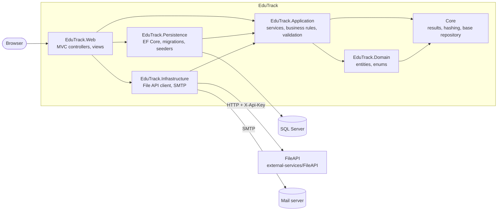

# EduTrack

**English** · [Türkçe](README.tr.md)

A classroom app for teachers and students: courses you join with a code, a course stream, materials, assignments with grading, and a class roster that shows who is behind.

[](https://github.com/Beratoguzhan620/edutrack/actions/workflows/ci.yml)


## Demo accounts

Start the app with demo content (see [Running locally](#running-locally)) and sign in with:

| Role | E-mail | Password |
|---|---|---|
| Teacher | `ogretmen@example.com` | `Demo123!` |
| Student | `zeynep@example.com` | `Demo123!` |
| Admin | `admin@example.com` | `Demo123!` |

The demo classroom has one teacher, eight students and three courses with posts, materials, assignments, submissions and grades.

## Features

- **Accounts:** registration with e-mail verification (6-digit code or link, resend with cooldown), login, roles (admin, teacher, student).
- **Courses:** teachers create courses and share a join code; students join with the code. Only members can see a course.
- **Stream:** announcements and automatic posts when a material or assignment is shared.
- **Materials:** files (stored by a separate File API) or links, with type and date.
- **Assignments:** due dates, text and file submissions, late submissions marked, grading with feedback. Students see their own status; teachers see every submission.
- **Roster:** class list with the number of overdue assignments per student.
- **Admin:** user list with search and filters; role management.
- **UI:** server-rendered pages, works down to 360 px, Turkish interface, loading states on every form.

## Screenshots

| Courses | Course stream |
|---|---|
|  |  |
| **Assignments** | **Assignment and grading** |
|  |  |
| **Roster** | **Materials** |
|  |  |

<p align="center"></p>

## Tech stack

- ASP.NET Core MVC on .NET 10, Razor views, Bootstrap 5 with a small custom design system ([docs/DESIGN.md](docs/DESIGN.md))
- Entity Framework Core 10 with SQL Server, code-first migrations
- FluentValidation, AutoMapper, Scrutor
- A separate File API (ASP.NET Core Web API with an API key) for uploads
- xUnit + Moq for unit tests, Playwright for UI screenshots
- GitHub Actions: build, tests, a Docker Compose smoke test and a UI preview on every pull request
- Docker / Docker Compose

## Architecture



Application defines the interfaces (`IFileService`, `IEmailSender`, repositories); Persistence and Infrastructure implement them, so the business rules do not depend on EF Core or HTTP. More in [docs/1-architecture.md](docs/1-architecture.md).

## Running locally

### With Docker (one command)

```bash
git clone https://github.com/Beratoguzhan620/edutrack.git
cd edutrack
docker compose up --build
```

- App: http://localhost:8080
- File API (Swagger): http://localhost:8081/swagger

Migrations and demo content are applied on first start. Without SMTP settings, verification e-mails are written to the log: `docker compose logs web`.

### With the .NET SDK

Requirements: .NET 10 SDK and SQL Server LocalDB (or change the connection string in `src/EduTrack.Web/appsettings.Development.json`).

```bash
# Terminal 1: File API on https://localhost:7005
dotnet run --project external-services/FileAPI --launch-profile https

# Terminal 2: web app on https://localhost:7014
dotnet run --project src/EduTrack.Web --launch-profile https
```

The Development settings already point the two apps at each other and turn on the demo content. Every setting can be overridden with environment variables; see [.env.example](.env.example).

### Deployment

The manual **Deploy EduTrack** workflow builds the image, pushes it to GitHub Container Registry and starts [deploy/docker-compose.yml](deploy/docker-compose.yml) on a server behind a reverse proxy. Settings live in a `.env` file on the server (`ConnectionStrings__DefaultConnection`, `FileApi__*`, `Admin__Password`, optional `Email__*`).

## Tests

```bash
dotnet test
```

Unit tests (xUnit + Moq) cover the business rules for courses, materials, assignments, users and sign-in, the assignment status logic and the e-mail verification flow. The UI preview workflow ([.github/workflows/ui-preview.yml](.github/workflows/ui-preview.yml)) starts the app against a throwaway SQL Server, walks through the main flows with Playwright at desktop and 360 px widths, and fails if a page scrolls sideways.

## Roadmap and known gaps

- Notifications (e-mail or in-app) when an assignment is due or graded.
- Integration tests against a real database.

The full history of the rebuild is in [docs/ROADMAP.md](docs/ROADMAP.md).

## Background

This project started as a bootcamp project and was later rebuilt from the ground up. What changed:

- **Design:** a new, consistent interface built on a small design system, usable on phones.
- **Features:** e-mail verification, assignments with submissions and grading, the class roster, the course stream, demo data.
- **Code:** membership checks in the service layer, validation, cleaner layering; the S3 dependency was replaced by a small File API.
- **Tests and CI:** unit tests, a Docker Compose smoke test and automated UI screenshots on every pull request.

## License

[MIT](LICENSE) · Berat Oğuzhan Turğut · [GitHub](https://github.com/Beratoguzhan620)
