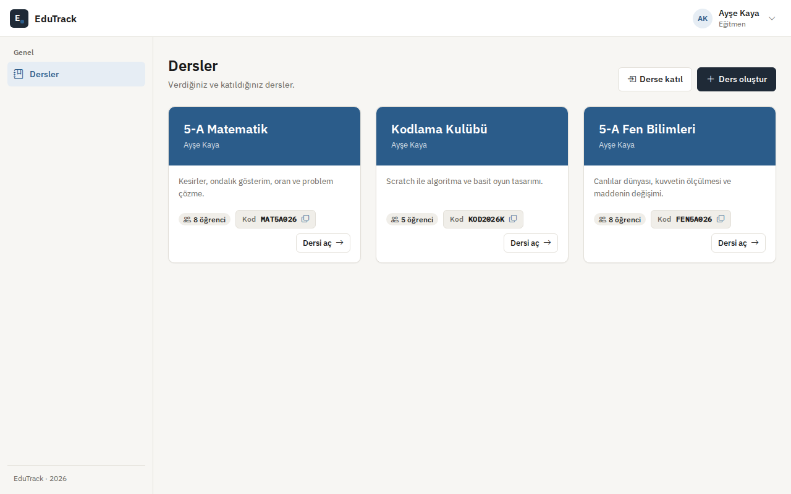
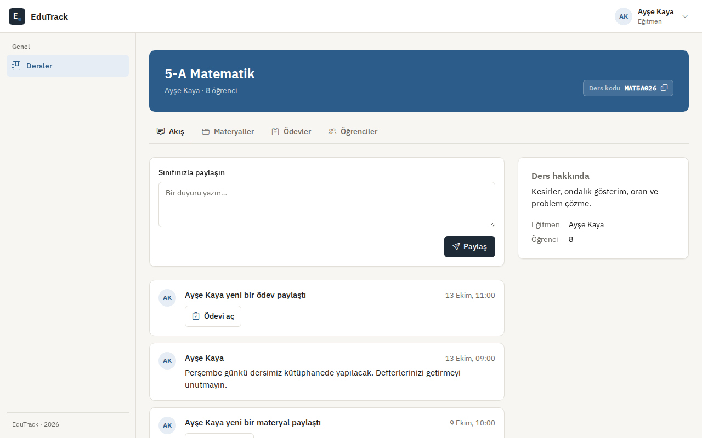
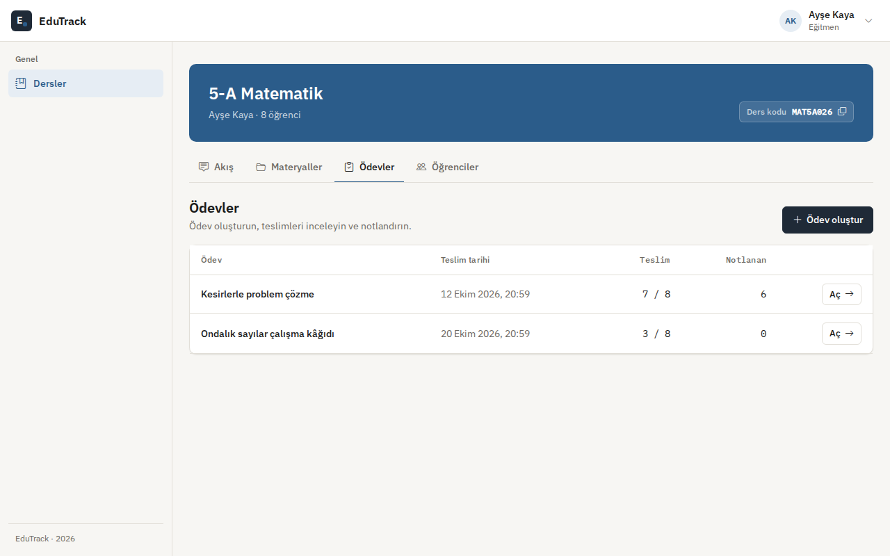
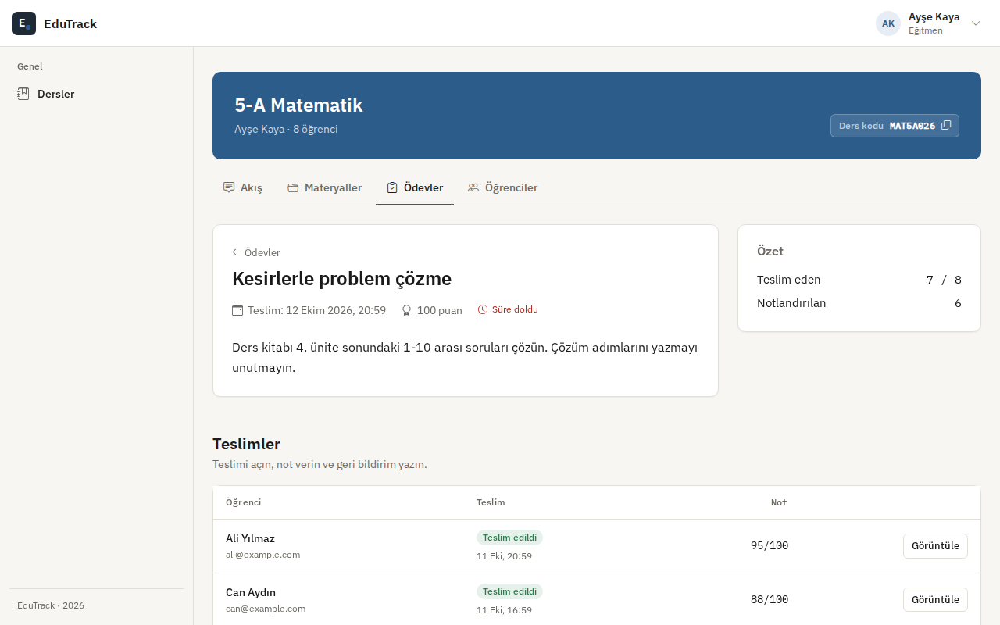
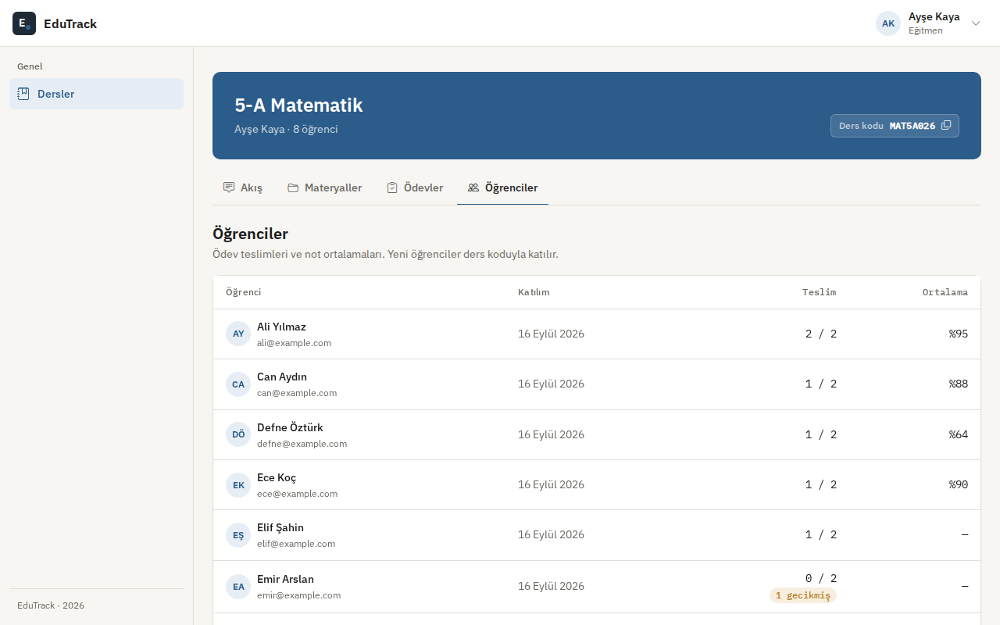
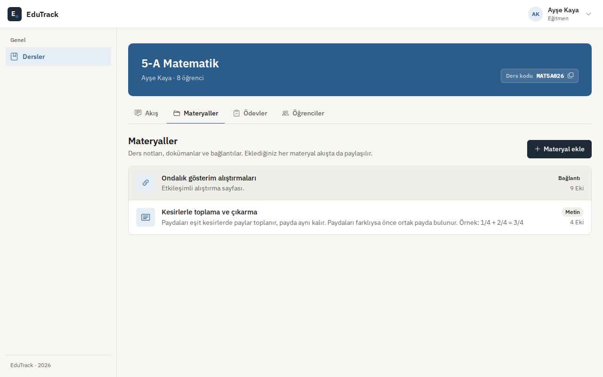
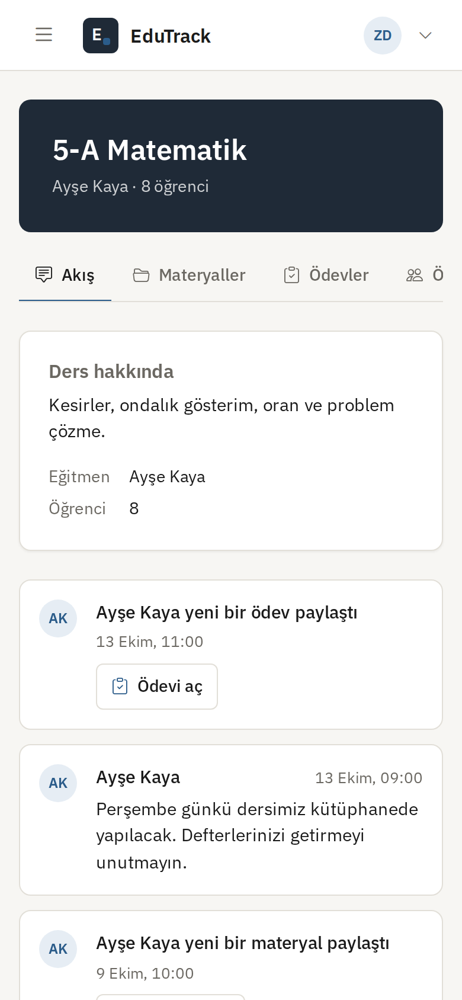
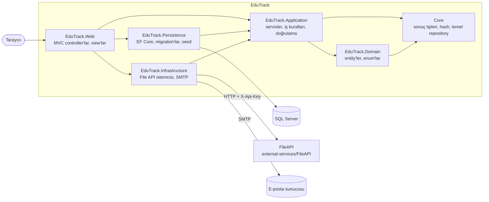

# EduTrack

[English](README.md) · **Türkçe**

Öğretmen ve öğrenciler için sınıf uygulaması: kodla katılınan dersler, ders akışı, materyaller, notlandırmalı ödevler ve kimin geride kaldığını gösteren sınıf listesi.

[](https://github.com/Beratoguzhan620/edutrack/actions/workflows/ci.yml)


## Demo hesapları

Uygulamayı demo içerikle başlatın ([Yerelde çalıştırma](#yerelde-çalıştırma)) ve şu hesaplarla giriş yapın:

| Rol | E-posta | Şifre |
|---|---|---|
| Öğretmen | `ogretmen@example.com` | `Demo123!` |
| Öğrenci | `zeynep@example.com` | `Demo123!` |
| Yönetici | `admin@example.com` | `Demo123!` |

Demo sınıfta bir öğretmen, sekiz öğrenci ve üç ders var; dersler duyuru, materyal, ödev, teslim ve notlarla dolu.

## Özellikler

- **Hesaplar:** e-posta doğrulamalı kayıt (6 haneli kod veya bağlantı, bekleme süreli yeniden gönderme), giriş, roller (yönetici, öğretmen, öğrenci).
- **Dersler:** öğretmen ders açar ve katılım kodunu paylaşır; öğrenci kodla katılır. Dersi yalnızca üyeleri görebilir.
- **Akış:** duyurular; materyal veya ödev paylaşılınca otomatik gönderi.
- **Materyaller:** ayrı bir File API'de saklanan dosyalar ya da bağlantılar; tür ve tarih bilgisiyle.
- **Ödevler:** teslim tarihi, metin ve dosya teslimi, geç teslim işareti, geri bildirimli notlandırma. Öğrenci kendi durumunu, öğretmen tüm teslimleri görür.
- **Sınıf listesi:** her öğrencinin süresi geçmiş ödev sayısıyla birlikte.
- **Yönetim:** arama ve filtreli kullanıcı listesi, rol yönetimi.
- **Arayüz:** sunucu tarafında üretilen sayfalar, 360 px genişliğe kadar sorunsuz, Türkçe arayüz, tüm formlarda yükleniyor durumu.

## Ekran görüntüleri

| Dersler | Ders akışı |
|---|---|
|  |  |
| **Ödevler** | **Ödev ve notlandırma** |
|  |  |
| **Sınıf listesi** | **Materyaller** |
|  |  |

<p align="center"></p>

## Teknolojiler

- .NET 10 üzerinde ASP.NET Core MVC, Razor view'lar, küçük bir tasarım sistemiyle Bootstrap 5 ([docs/DESIGN.md](docs/DESIGN.md))
- Entity Framework Core 10 + SQL Server, code-first migration'lar
- FluentValidation, AutoMapper, Scrutor
- Dosya yüklemeleri için ayrı bir File API (API anahtarlı ASP.NET Core Web API)
- Birim testleri için xUnit + Moq, arayüz görüntüleri için Playwright
- GitHub Actions: her pull request'te build, testler, Docker Compose duman testi ve arayüz önizlemesi
- Docker / Docker Compose

## Mimari



Arayüzler (`IFileService`, `IEmailSender`, repository'ler) Application katmanında tanımlı; Persistence ve Infrastructure bunları uygular. Böylece iş kuralları EF Core'a veya HTTP'ye bağlı değil. Ayrıntılar: [docs/1-architecture.md](docs/1-architecture.md).

## Yerelde çalıştırma

### Docker ile (tek komut)

```bash
git clone https://github.com/Beratoguzhan620/edutrack.git
cd edutrack
docker compose up --build
```

- Uygulama: http://localhost:8080
- File API (Swagger): http://localhost:8081/swagger

Migration'lar ve demo içerik ilk açılışta uygulanır. SMTP ayarı yoksa doğrulama e-postaları log'a yazılır: `docker compose logs web`.

### .NET SDK ile

Gerekenler: .NET 10 SDK ve SQL Server LocalDB (ya da `src/EduTrack.Web/appsettings.Development.json` içindeki bağlantı cümlesini değiştirin).

```bash
# 1. terminal: File API, https://localhost:7005
dotnet run --project external-services/FileAPI --launch-profile https

# 2. terminal: web uygulaması, https://localhost:7014
dotnet run --project src/EduTrack.Web --launch-profile https
```

Development ayarları iki uygulamayı birbirine bağlar ve demo içeriği açar. Tüm ayarlar ortam değişkeniyle değiştirilebilir; liste için [.env.example](.env.example).

### Yayına alma

Elle çalıştırılan **Deploy EduTrack** iş akışı imajı derler, GitHub Container Registry'ye gönderir ve sunucuda reverse proxy arkasında [deploy/docker-compose.yml](deploy/docker-compose.yml) dosyasını başlatır. Ayarlar sunucudaki `.env` dosyasında durur (`ConnectionStrings__DefaultConnection`, `FileApi__*`, `Admin__Password`, isteğe bağlı `Email__*`).

## Testler

```bash
dotnet test
```

Birim testleri (xUnit + Moq) ders, materyal, ödev, kullanıcı ve giriş iş kurallarını, ödev durumu mantığını ve e-posta doğrulama akışını kapsar. UI preview iş akışı ([.github/workflows/ui-preview.yml](.github/workflows/ui-preview.yml)) uygulamayı geçici bir SQL Server ile başlatır, ana akışları Playwright ile masaüstü ve 360 px genişlikte dolaşır ve yatay kaydırma olan sayfada hata verir.

## Yol haritası ve bilinen eksikler

- Ödev teslim tarihi yaklaşınca veya not verilince bildirim (e-posta ya da uygulama içi).
- Gerçek veritabanıyla entegrasyon testleri.

Yeniden yapımın tüm aşamaları: [docs/ROADMAP.md](docs/ROADMAP.md).

## Proje geçmişi

Bu proje bir bootcamp projesi olarak başladı, sonra baştan geliştirildi. Neler değişti:

- **Tasarım:** küçük bir tasarım sistemine dayanan, telefonda da rahat kullanılan yeni ve tutarlı arayüz.
- **Özellikler:** e-posta doğrulama, teslim ve notlandırmalı ödevler, sınıf listesi, ders akışı, demo veri.
- **Kod:** servis katmanında üyelik kontrolleri, doğrulama, daha temiz katmanlar; S3 bağımlılığı yerine küçük bir File API.
- **Test ve CI:** birim testleri, Docker Compose duman testi ve her pull request'te otomatik arayüz görüntüleri.

## Lisans

[MIT](LICENSE) · Berat Oğuzhan Turğut · [GitHub](https://github.com/Beratoguzhan620)
